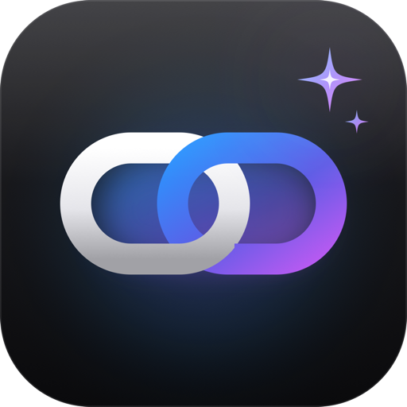
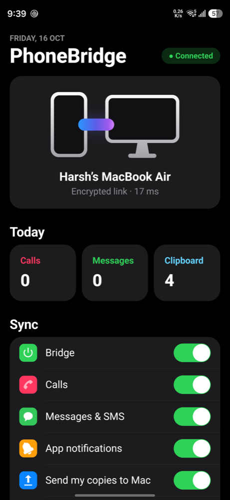

<p align="center"></p>

<h1 align="center">PhoneBridge</h1>

<p align="center"><sub>by <a href="https://www.harshkit.com/">Harshkit</a></sub></p>

<p align="center"><b>Apple-style continuity between your Android phone and your Mac.</b><br>
Calls, messages and notifications on your Mac. OTP codes copied for you. One clipboard across both.<br>
Free, open source, end-to-end encrypted, and it never touches the internet.</p>

<p align="center">
  <a href="https://github.com/harshkit/phonebridge/releases/latest"></a>
  
  
  
  <a href="LICENSE"></a>
</p>

<p align="center"><a href="https://www.harshkit.com/apps/phonebridge/">Website</a> · <a href="#install-one-line">Install</a> · <a href="#features">Features</a> · <a href="#how-it-works">How it works</a> · <a href="SECURITY.md">Security</a> · <a href="PRIVACY.md">Privacy</a></p>

---

iPhone owners get Continuity for free: texts on the Mac, codes that paste themselves, copy on one device and paste on the other. If your phone is a Samsung, Pixel or any other Android, you don't. **PhoneBridge closes that gap**: a small Android app and a Mac menu-bar app that talk directly to each other over your Wi-Fi, with no cloud, no account and no subscription.

<p align="center"></p>

## Install (one line)

On your Mac:

```bash
curl -fsSL https://raw.githubusercontent.com/harshkit/phonebridge/main/install.sh | bash
```

It installs the Mac app (menu bar, starts at login), then pairs your phone over Wi-Fi. On the phone you'll need **Settings → Developer options → Wireless debugging → Pair device with pairing code** once. The installer asks for the code shown there. After that, there's nothing to run: both sides connect on their own whenever they're on the same Wi-Fi.

**Requirements:** a Mac on macOS 14 or later, an Android phone on Android 13 or later, both on the same Wi-Fi network. Tested on a Samsung Galaxy S26 Ultra (Android 17) with a MacBook Air.

## Features

- 📞 **Calls on your Mac.** Incoming calls appear as time-sensitive Mac alerts, showing the caller the way your phone does.
- 💬 **Messages and SMS.** WhatsApp, Messages, Telegram and everything else your phone shows, as native macOS notifications. Swipe one away on the phone and it disappears from the Mac.
- 🔐 **OTP auto-copy.** When a verification code arrives, it's already on your Mac's clipboard: just press **⌘V**. Works with bank SMS, Google, and "123 456"-style codes; ignores amounts like "₹1500".
- 📋 **One clipboard.** Copy text, links or images on either device and paste on the other. Passwords copied from Mac password managers are never sent.
- 🎛️ **You're in control.** Turn each piece on or off from the phone: calls, messages, other apps, sending copies, receiving copies.
- ⚡ **Fast.** One persistent connection with no batching: an OTP reaches the Mac clipboard in ~25 ms; a typical round trip on home Wi-Fi is under 20 ms.
- 🔁 **Seamless.** The Mac app starts at login and relaunches itself if it ever crashes; the Android side runs as a system-managed notification listener, reconnects in milliseconds to a known Mac and falls back to Bonjour discovery if your Mac's address changes.

## How it works

```
 Android (Kotlin, no libraries)                     Mac (Swift, menu bar)
 ┌──────────────────────────────┐   same Wi-Fi    ┌──────────────────────────────┐
 │ NotificationListenerService  │  TCP :47811     │ Bonjour  _phonebridge._tcp   │
 │ SMS receiver (full OTP text) │ ◀─────────────▶ │ macOS notifications          │
 │ Clipboard watcher            │  X25519 + AES   │ OTP → clipboard              │
 │ Toggles, status              │  -256-GCM       │ Clipboard watcher            │
 └──────────────────────────────┘                 └──────────────────────────────┘
```

Android deliberately makes a few of these things hard for apps. Here's what PhoneBridge does about each, all with your consent over `adb` during setup:

| Android limit | What PhoneBridge does |
|---|---|
| Apps can't read other apps' notifications | Uses the official **notification access** permission, granted by setup (sideloaded apps can't flip it on themselves on Android 13+). |
| Android 10+ blocks reading the clipboard in the background | The system logs `Denying clipboard access to <app>` whenever the clipboard changes. With **READ_LOGS** granted over adb, PhoneBridge watches for that one line (filtered to `ClipboardService` only), shows a 1-pixel invisible window for a few milliseconds to gain focus, reads the clip and closes. KDE Connect uses the same technique. |
| Android 15+ hides OTP text from notification listeners | PhoneBridge reads the **SMS itself** (RECEIVE_SMS), so the full code reaches your Mac. |
| Samsung filters Wi-Fi multicast, hiding Bonjour | Takes a **multicast lock** during discovery, and remembers the Mac's address so it rarely needs discovery at all. |
| Battery savers drop background connections | Setup adds PhoneBridge to the battery-optimisation allowlist. |

## Security and privacy

- **End-to-end encrypted, no server.** Your phone talks only to your Mac. Every connection runs a fresh **X25519** key exchange, authenticated by a 256-bit key that's created on your Mac and handed to your phone once over adb. Messages are sealed with **AES-256-GCM** and carry strict sequence numbers, so nothing on your network can read, alter or replay them. Old sessions stay sealed even if the pairing key leaks later (forward secrecy).
- **Locked pairing.** Only `adb` (your computer, with your consent) can pair the app; other apps on the phone can't re-pair it to themselves.
- **No telemetry, no account, no internet.** See [PRIVACY.md](PRIVACY.md).
- **Tested against attacks.** `mac/test/run.sh` runs a fake phone against the real Mac app: it checks the handshake, OTP copy and clipboard, then tries a replayed message, a wrong key and an old-session message (all rejected), and captures the traffic to prove no content crosses the wire readable.

What it doesn't protect against, and the exact design, is in [SECURITY.md](SECURITY.md).

## Build from source

```bash
git clone https://github.com/harshkit/phonebridge && cd phonebridge
./mac/build.sh          # builds and installs the Mac app (needs Xcode Command Line Tools)
./setup.sh              # builds the Android app and pairs your phone (needs JDK 17 + Android SDK)
./mac/test/run.sh       # security tests against the running Mac app
```

Install the Android build tools with `brew install openjdk@17 && brew install --cask android-commandlinetools android-platform-tools`, then set `ANDROID_HOME` to the SDK folder.

## Project layout

| Path | What |
|---|---|
| `android/app/src/main/java/com/harshkit/phonebridge/Bridge.kt` | Link, encryption, notification listener, SMS, clipboard |
| `android/app/src/main/java/com/harshkit/phonebridge/Ui.kt` | The phone app's screen |
| `mac/main.swift` | The whole Mac app |
| `install.sh`, `setup.sh`, `mac/install-app.sh` | Installer, phone setup, Mac install |
| `mac/test/` | Fake-phone attack tests and wire sniffer |
| `icon/` | Icon master (`icon.svg`) and the script that renders every platform size |

## Roadmap

- Reply to messages from the Mac notification
- Drop files between phone and Mac (AirDrop-style)
- One-click hotspot from the Mac menu bar

Ideas and bug reports are welcome in [Issues](https://github.com/harshkit/phonebridge/issues).

## License

[MIT](LICENSE) © 2026 Harsh Sharma · [Harshkit](https://www.harshkit.com/). Not affiliated with Apple, Google or Samsung.
